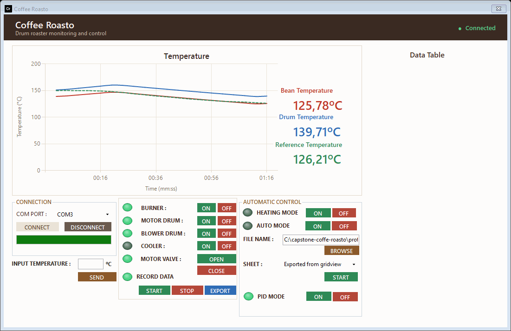
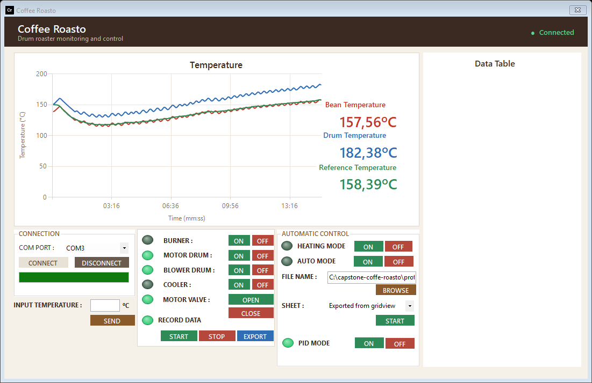
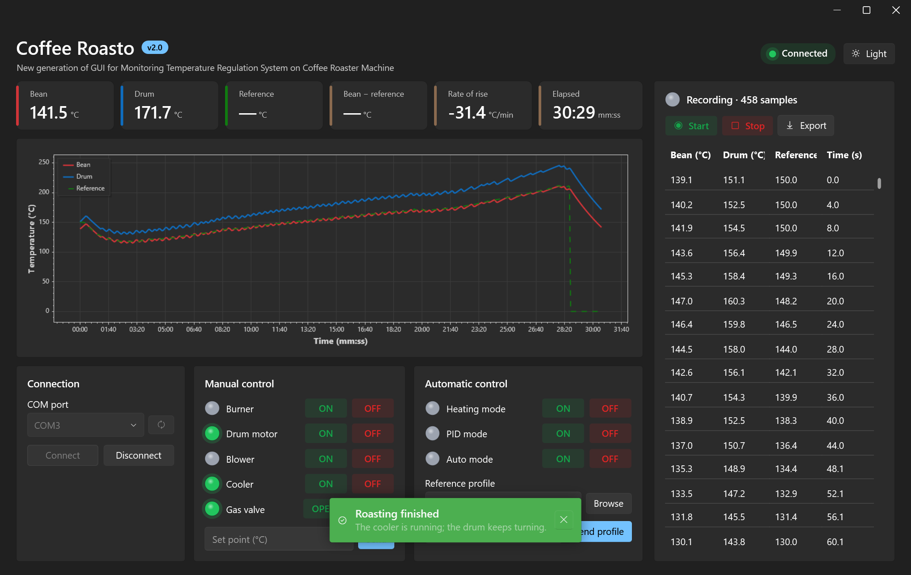
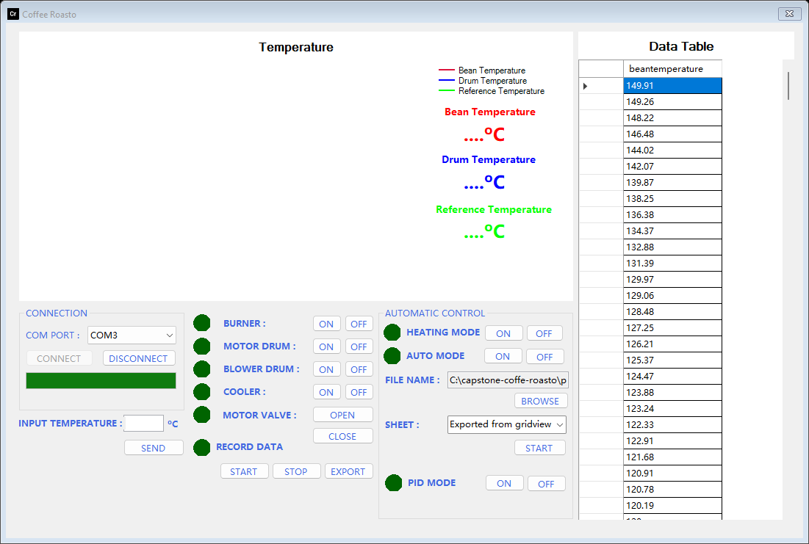
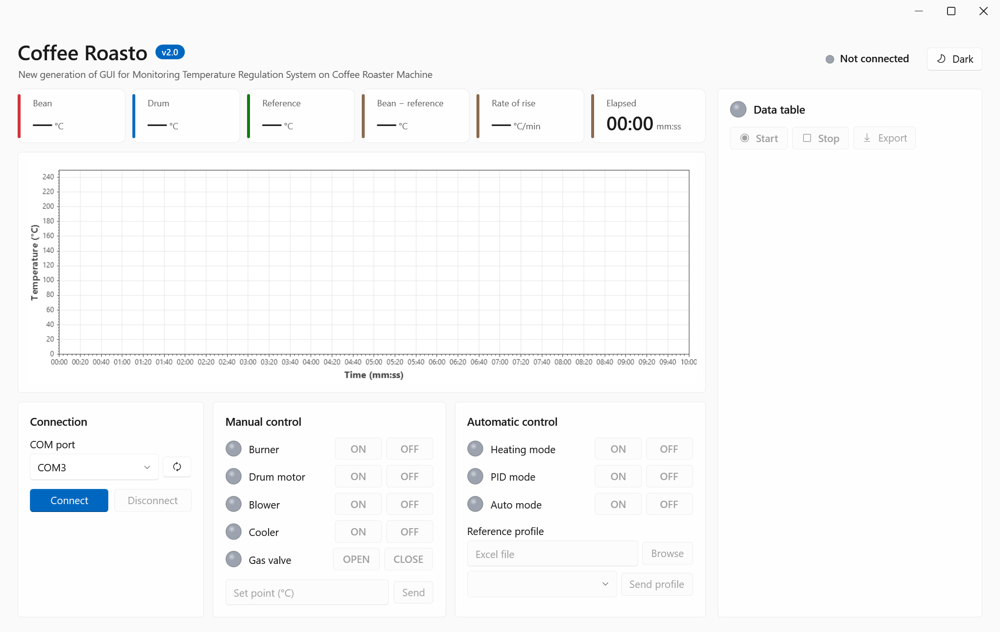
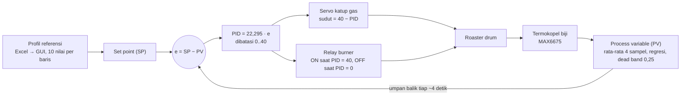
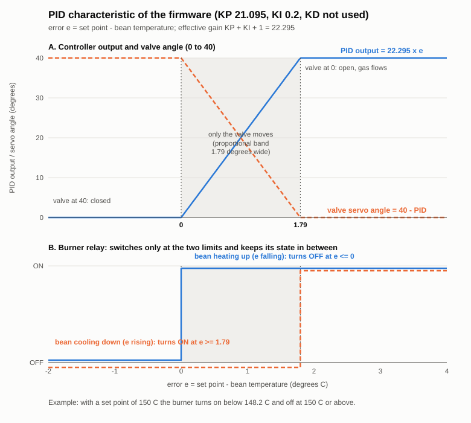
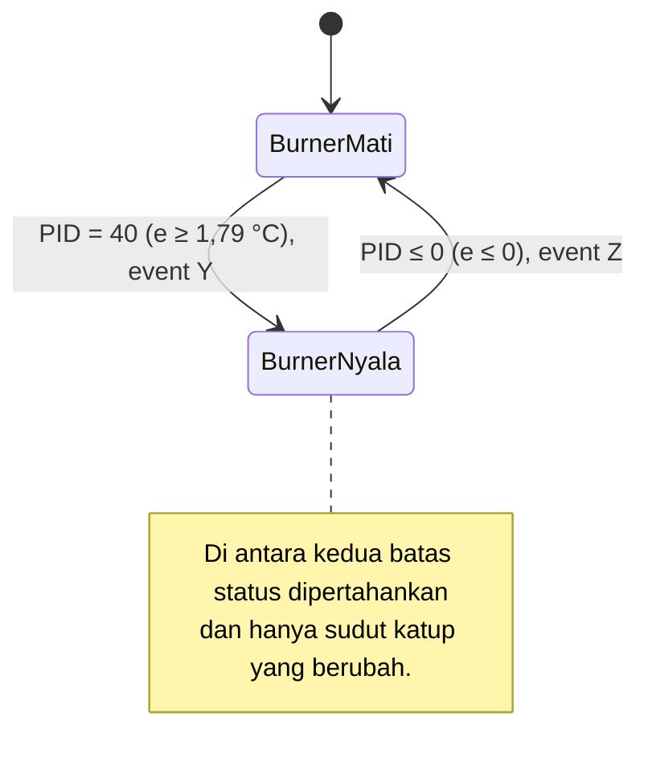

# Coffee Roasto v2.0

[English](README.md)

**New generation of GUI for Monitoring Temperature Regulation System on Coffee Roaster Machine.**

Coffee Roasto adalah proyek capstone yang mengotomatiskan mesin sangrai kopi tipe drum. Arduino membaca dua termokopel dan menggerakkan kompor, motor drum, blower, cooler, dan valve gas; aplikasi desktop Windows menampilkan suhu secara langsung, merekamnya, dan menjalankan roasting otomatis dengan kontroler PID yang mengikuti profil suhu referensi. Versi 2.0 adalah aplikasi baru bergaya Fluent di .NET 10.

> Status: aplikasi dan firmware Arduino sudah dibangun dan diuji tanpa mesin (lihat [pengujian](docs/id/testing.md)). Jalankan daftar pengecekan di [panduan deploy](docs/id/deployment.md) dengan kompor dilepas sebelum roasting sungguhan pertama.

## Sorotan
- Desain Fluent (WPF-UI): kartu, latar Mica di Windows 11, **tema terang dan gelap** dengan satu klik
- Grafik langsung (ScottPlot) suhu biji, drum, dan referensi dengan sumbu mm:ss, zoom, dan pan
- Kartu angka: biji, drum, referensi, **biji − referensi**, **rate of rise (°C/menit)**, dan waktu berjalan
- Kontrol manual kompor, motor drum, blower, cooler, dan valve gas dengan lampu status
- Mode heating: memanaskan drum sampai 150 °C selama 10 menit
- Mode PID: mengikuti profil referensi dari file Excel (suhu biji per langkah)
- Pengaman berhenti di 250 °C dan toast "roasting selesai" dari hardware
- Rekam sesi dan ekspor ke `.xlsx` (Excel tidak perlu terpasang)
- Satu `.exe` self-contained, PC mesin tidak butuh .NET maupun installer

## Tech stack
C# · .NET 10 · WPF · WPF-UI (Fluent) · ScottPlot 5 · CommunityToolkit.Mvvm · ClosedXML · ExcelDataReader ·
xUnit · Arduino (C++) · penguat termokopel MAX6675 · Servo · serial USB (9600 baud)

## Dokumentasi
- [Kebutuhan (sesuai yang dibangun)](docs/id/PRD.md)
- [Desain sistem](docs/id/system-design.md)
- [Keputusan arsitektur](docs/id/adr/)
- [Protokol serial](docs/id/serial-protocol.md)
- [Panduan hardware](docs/id/hardware.md)
- [Tanya jawab teknis](docs/id/technical-qa.md)
- [Pengujian dan demo](docs/id/testing.md)
- [Build, instalasi, dan operasi](docs/id/deployment.md)
- [Changelog](CHANGELOG.md)
- Diagram (Mermaid): [`docs/en/diagrams/`](docs/en/diagrams/)

## Struktur repositori
| Path | Isi |
| --- | --- |
| `src/CoffeeRoasto.Core/` | Logika tanpa layar: koneksi serial, parser baris, profil, perekaman, ekspor Excel |
| `src/CoffeeRoasto.App/` | Aplikasi WPF: jendela, view model, kontrol |
| `firmware/Program_PID_CP/` | Firmware yang berjalan di mesin (tab: config, aktuator, sensor, PID, mode) |
| `firmware/Pengujian_Hardware/` | Sketsa uji relay |
| `firmware/moveServo/` | Sketsa ramp servo yang belum selesai (tidak bisa dikompilasi, lihat keterbatasan) |
| `tests/CoffeeRoasto.Tests/` | Tes xUnit untuk `Core` dan view model |
| `tests/firmware-sim/` | Firmware dijalankan di PC, beserta jejak emas firmware asli |
| `tools/screenshots/` | Memutar ulang roasting lewat jendela asli dan menyimpan screenshot |
| `profiles/` | Contoh profil suhu referensi (`.xls`, `.xlsx`) |
| `installer/` | `publish.ps1` untuk `.exe` single-file; installer ClickOnce v1.0 di `v1-clickonce/` |
| `check.ps1` | Restore, build, tes, dan simulasi firmware dalam satu perintah |

## Demo
Gambar berasal dari jendela asli yang memutar ulang satu roasting penuh 29 menit hasil simulasi firmware (lihat [pengujian dan demo](docs/id/testing.md)).



<table>
<tr><td align="center" valign="top"><br><sub>Mode PID setelah 15 menit: suhu biji mengikuti referensi</sub></td><td align="center" valign="top"><br><sub>Tema gelap, dengan toast saat roasting selesai</sub></td></tr>
<tr><td align="center" valign="top"><br><sub>Profil referensi dimuat dari Excel</sub></td><td align="center" valign="top"><br><sub>Layar awal, semua mati sampai Connect</sub></td></tr>
</table>

## Memulai
Kebutuhan: Windows 10 (1607) atau lebih baru, 64-bit. Untuk build: .NET 10 SDK. Untuk firmware: Arduino IDE dengan `MAX6675 library`.

```text
1. Unggah firmware/Program_PID_CP/Program_PID_CP.ino ke board (Arduino IDE; pasang "MAX6675 library").
2. Jalankan aplikasi:  dotnet run --project src/CoffeeRoasto.App -c Release
   atau publish:      ./installer/publish.ps1   ->  installer/dist/CoffeeRoasto.exe (sekitar 74 MB, self-contained)
3. Colokkan board, jalankan Coffee Roasto, pilih port COM, lalu tekan Connect.
```

| Aksi | Fungsi |
| --- | --- |
| Connect / Disconnect | Membuka atau menutup port serial 9600 baud; kartu kontrol nonaktif sebelum terhubung |
| Burner, Drum motor, Blower, Cooler, Gas valve | ON/OFF manual (valve: OPEN/CLOSE); lampu menyala saat aktif |
| Heating mode ON/OFF | Pemanasan ke 150 °C selama 600 detik dengan motor drum dan blower hidup |
| PID mode ON | Memulai loop PID dengan set point 150 °C sampai profil dikirim |
| Browse, sheet, Send profile | Memuat kolom `beantemperature` dari sheet Excel dan mengirimnya ke board per 10 data |
| Set point + Send | Memberi PID satu suhu referensi secara manual |
| Start / Stop / Export | Mengumpulkan data ke kartu data dan mengekspornya ke `.xlsx` |
| Dark / Light | Mengganti tema jendela dan grafik |

Semua yang bisa diperiksa tanpa mesin berjalan dengan `./check.ps1` (restore, build, 32 tes, simulasi firmware).

## Kendali PID (firmware)
PID berjalan di Arduino, bukan di aplikasi (ADR-002). Kode: `firmware/Program_PID_CP/` (`Pid.ino`, `PidMode.ino`, `Actuators.ino`, `ReferenceProfile.h`, `Config.h`).

### Loop kendali


| Elemen | Di proyek ini |
| --- | --- |
| Proses | Roaster kopi tipe drum dengan burner gas |
| Process variable (PV) | Suhu biji, termokopel tipe K lewat MAX6675 |
| Set point (SP) | Profil referensi dari Excel, dikirim GUI sepuluh nilai sekali kirim; 150 °C sebelum profil tiba; 0 mengakhiri roasting |
| Aktuator | Servo katup gas (0° terbuka, 40° tertutup) dan relay burner (active LOW) |
| Periode sampling | Satu pembaruan tiap ~4 detik (sampel 1 detik, 4 dirata-rata) |

### Perhitungan (`computePid`)
```text
e   = SP - PV
P   = KP * e                 KP = 21,095
I   = KI * (e + e_prev)      KI = 0,2
D   = e - e_prev
PID = P + I + D, dibatasi 0..40
```
Gain berasal dari simulasi MATLAB. `e_prev` adalah konstanta 0 dan `KD` (30 di simulasi) tidak dipakai, sehingga secara efektif
**PID = (KP + KI + 1) * e = 22,295 * e**: pengendali proporsional dengan satu gain gabungan, bukan integral atau turunan yang
sesungguhnya (desain sistem, keterbatasan 1). Kode sengaja dipertahankan persis seperti sketsa asli; hasil refactor sudah
dicek terhadap sketsa asli dengan golden trace.

### Dari nilai PID ke aktuator
- **Katup:** `servo = 40 - PID`. Error besar menghasilkan PID = 40 dan katup di 0° (terbuka, gas mengalir); error 0 atau negatif menghasilkan 40° (tertutup). Sudah dikonfirmasi di mesin.
- **Relay burner:** menyala hanya saat PID mencapai 40 (error sekitar 1,79 °C atau lebih) dan mati saat PID mencapai 0 (suhu biji sama dengan atau di atas set point). Di antaranya status relay dipertahankan dan hanya katup yang bergerak, sehingga relay tidak bolak-balik (chattering).
- **Praktisnya:** pita proporsional hanya sekitar 1,8 °C, jadi loop berperilaku mendekati on/off dengan sedikit modulasi di dekat set point.



Grafik digambar dari konstanta di `Config.h` oleh `tools/pid-charts/make_charts.py` (`python tools/pid-charts/make_charts.py`); jalankan ulang bila gain berubah. Grafik ini menunjukkan rumusnya, bukan hasil roasting yang terukur.



### Penanganan set point
`ReferenceProfile` memakai dua buffer (*pending* dan *active*). Satu set point dipakai per pembacaan rata-rata (~4 detik), jadi
sepuluh nilai bertahan sekitar 40 detik. Baris baru tidak pernah menimpa nilai yang sedang diikuti; bila tidak ada baris baru,
grup aktif dipakai ulang.

### Pengaman di sekitar loop
`s` dari GUI menghentikan mode PID dan mematikan burner. Suhu biji 250 °C atau lebih menghentikannya secara otomatis. Set point 0
mengakhiri roasting (burner dan blower mati, drum tetap berputar, cooler menyala). Karena loop ada di board, semua ini tetap
bekerja walau PC hang.

### Kesimpulan: alasan memilih PID, kelebihan, dan kekurangan
**Alasan PID.** Tujuan (PRD) adalah membuat suhu biji mengikuti profil referensi secara otomatis. Itu masalah pelacakan set point
dengan satu keluaran terukur dan satu masukan panas yang bisa diatur, yaitu penggunaan standar pengendali PID. PID tidak butuh
model roaster yang rinci, cukup ringan dijalankan di AVR dengan periode 4 detik, dan tim bisa mensimulasikan serta menyetelnya
lebih dulu di MATLAB. Menjalankannya di Arduino menjaga periode kendali tetap stabil dan aturan keselamatan tidak bergantung pada
PC (ADR-002). Repositori mencatat keputusan menaruh loop di board (ADR-002) dan asal gain dari MATLAB; tidak ada catatan terpisah
yang membandingkan PID dengan metode kendali lain, jadi alasan di atas adalah rasional rekayasa, bukan kutipan keputusan.

| Kelebihan | Kekurangan |
| --- | --- |
| Mengikuti profil yang berubah, bukan hanya satu suhu tetap | Suku I dan D yang diimplementasikan tidak sungguhan: tidak ada akumulasi error dan laju perubahan, jadi tidak ada penghapusan steady-state error dan tidak ada peredaman |
| Ringan: beberapa operasi float tiap 4 detik | Pita proporsional sempit (sekitar 1,8 °C), jadi hampir seperti on/off dan berpotensi berosilasi di sekitar set point |
| Loop tertutup: bereaksi pada suhu biji terukur, bukan pada timer | Gain MATLAB tidak sepenuhnya diterapkan, sehingga perilaku bisa berbeda dari simulasi |
| Batas keluaran (0..40) sesuai rentang servo | Tidak ada anti-windup atau pembatas laju, dan periode sampel 4 detik lambat dibanding delay termal drum |
| Keselamatan (stop 250 °C, `s`) ada di board | Penyetelan berarti flash ulang; GUI tidak bisa mengubah gain (di luar lingkup PRD) |
| Pensaklaran burner berhisterisis, relay tidak chattering | Tidak ada watchdog: bila kabel dicabut, board mempertahankan mode terakhir |

Kekurangan soal osilasi dan offset steady-state diambil dari pembacaan kode; belum diukur pada roasting nyata.
Untuk PID yang sebenarnya: simpan `previousError`, tambahkan akumulator integral dengan anti-windup, pakai `KD` dengan periode
4 detik, lalu setel ulang di mesin. Itu mengubah cara burner gas dikendalikan, jadi uji dulu dengan burner dilepas dan perbarui golden trace.

## Keselamatan
Firmware mematikan kompor dan berhenti di 250 °C, tetapi kompor gas, drum panas, dan bagian yang bergerak tetap berbahaya. Jangan tinggalkan proses roasting tanpa pengawasan; uji perubahan dengan kompor dilepas dahulu.
