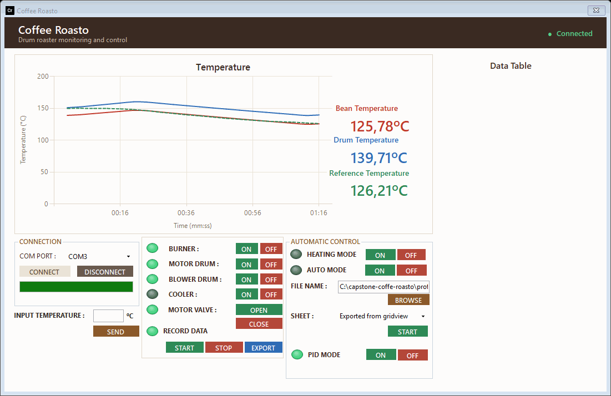
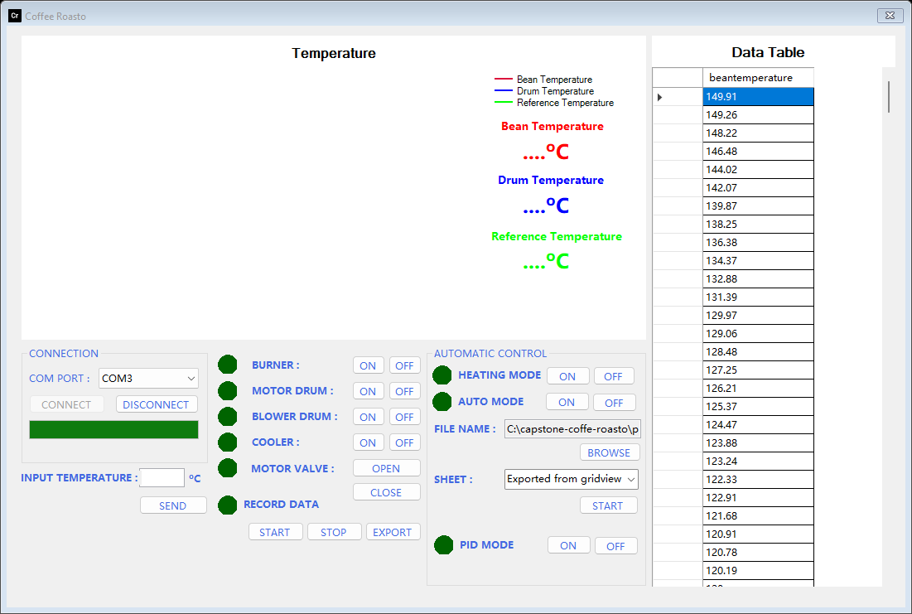
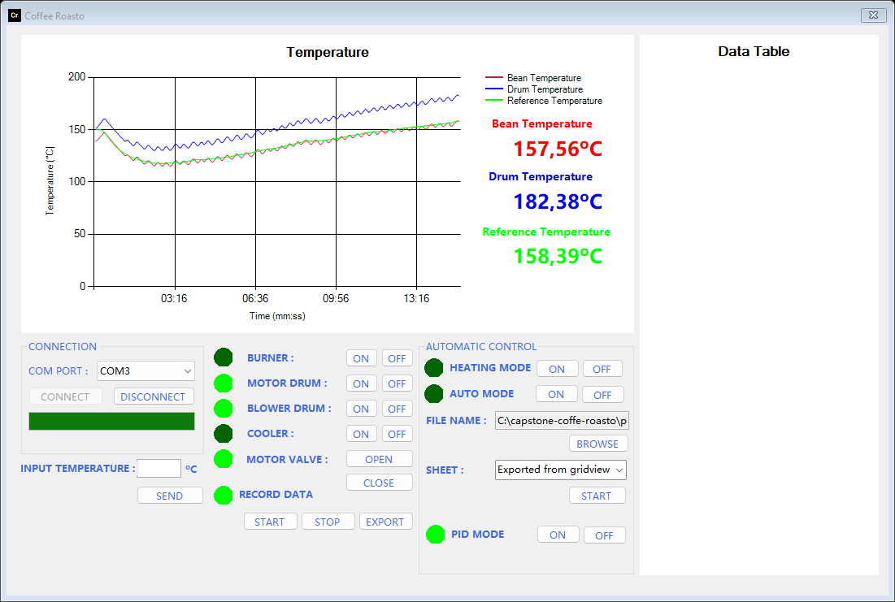
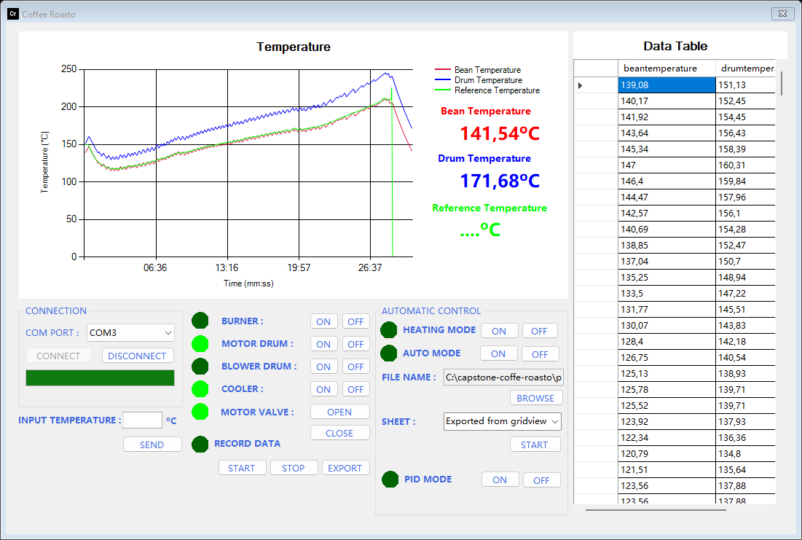
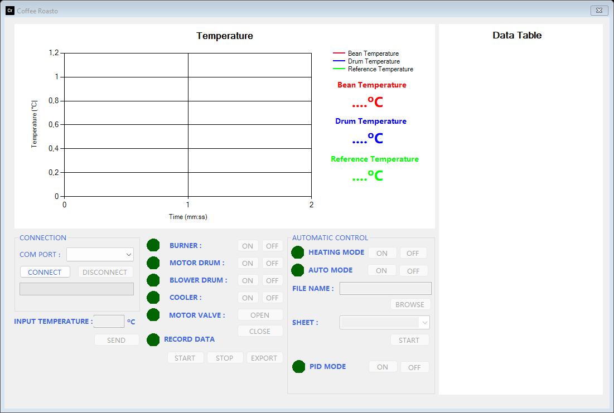

# Coffee Roasto — Coffee Roaster Monitoring and Control

[Bahasa Indonesia](README.id.md)

Coffee Roasto is a capstone project that automates a drum coffee roaster. An Arduino reads two thermocouples and
drives the burner, drum motor, blower, cooler and gas valve; a Windows desktop app shows the temperatures live,
records them, and runs roasting automatically with a PID controller that follows a reference temperature profile.

> Status: the GUI and the Arduino firmware are built and were tested on the roaster. Known gaps are listed in the
> [system design](docs/en/system-design.md#10-known-limitations).

## Highlights
- Live bean, drum and reference temperature on a chart, one reading every 4 seconds
- Manual control of burner, drum motor, blower, cooler and valve with pilot lamps that show the state
- Heating mode: pre-heats the drum to 150 °C for 10 minutes
- PID mode: follows a reference profile loaded from an Excel file (bean temperature per step)
- Safety stop at 250 °C and a "roasting done" signal from the hardware
- Record the session and export it to Excel

## Tech stack
C# · .NET Framework 4.7.2 · Windows Forms · Chart (DataVisualization) · ExcelDataReader · Excel Interop ·
Arduino (C++) · MAX6675 thermocouple amplifiers · Servo · USB serial (9600 baud)

## Documentation
- [Requirements (as built)](docs/en/PRD.md)
- [System design](docs/en/system-design.md)
- [Architecture decisions](docs/en/adr/)
- [Serial protocol](docs/en/serial-protocol.md)
- [Hardware guide](docs/en/hardware.md)
- [Technical Q&A](docs/en/technical-qa.md)
- [Testing and demo](docs/en/testing.md)
- [Build, install and operate](docs/en/deployment.md)
- Diagrams (Mermaid): [`docs/en/diagrams/`](docs/en/diagrams/)

## Repository layout
| Path | What it holds |
| --- | --- |
| `gui/` | Visual Studio solution of the desktop app (`Form1.cs`, `Coffee.cs`, `PilotLamp.cs`) |
| `installer/` | ClickOnce installer for the GUI (`setup.exe`, `CoffeeRoasto_GUI.application`, `autorun.inf`) |
| `tests/` | GUI logic tests and the firmware simulation with its golden traces |
| `tools/screenshots/` | Replays a roast through the real window and saves the screenshots |
| `profiles/` | Sample reference temperature profiles (`.xls`, `.xlsx`) |
| `firmware/Program_PID_CP/` | The firmware that runs on the roaster |
| `firmware/Pengujian_Hardware/` | Relay test sketch |
| `firmware/moveServo/` | Unfinished servo ramp sketch (does not compile, see limitations) |

## Demo
The pictures come from the real window, replaying a whole 29-minute roast that the firmware simulation produced (see [testing and demo](docs/en/testing.md)).



<table>
<tr><td align="center" valign="top"><br><sub>A reference profile loaded from Excel</sub></td><td align="center" valign="top"><br><sub>PID mode after 15 minutes: the bean temperature follows the reference</sub></td></tr>
<tr><td align="center" valign="top"><br><sub>Roast finished, recording in the data table</sub></td><td align="center" valign="top"><br><sub>Start screen, everything off until CONNECT</sub></td></tr>
</table>

## Tests
```powershell
tests/gui-logic/run.ps1      # 69 checks on the parser, profile splitting and recording
tests/firmware-sim/run.ps1   # the firmware on the PC, 12 scenarios compared with traces of the original firmware
```
There is no roaster in the loop: see [what is and is not tested](docs/en/testing.md#5-what-is-not-tested).

## Getting started
Requirements: Windows with .NET Framework 4.7.2, Microsoft Excel (only for the export button), Visual Studio 2017 or
newer (to build the GUI), Arduino IDE with the `MAX6675` library (to flash the firmware).

```text
1. Open firmware/Program_PID_CP/Program_PID_CP.ino in the Arduino IDE,
   install the "MAX6675" library, and upload it to the board.
2. Install the GUI: run "installer/setup.exe"
   (or open CoffeeRoasto_GUI.sln in Visual Studio and press F5).
3. Plug the board in, start Coffee Roasto, pick the COM port and press CONNECT.
```

Windows regional settings must use a comma as the decimal separator (for example Indonesian); see
[troubleshooting](docs/en/deployment.md#troubleshooting).

| Action | What it does |
| --- | --- |
| CONNECT / DISCONNECT | Opens or closes the serial port at 9600 baud; all controls stay disabled until connected |
| Burner, Motor drum, Blower drum, Cooler, Motor valve | Manual ON/OFF (valve: OPEN/CLOSE); the lamp turns lime when on |
| HEATING MODE ON/OFF | Pre-heat to 150 °C for 600 s with drum motor and blower on |
| PID MODE ON | Starts the PID loop with a 150 °C set point until a profile is sent |
| BROWSE + SHEET + START | Loads the `beantemperature` column of an Excel sheet and sends it to the board in groups of 10 |
| INPUT TEMPERATURE + SEND | Sets a single reference temperature by hand |
| RECORD DATA START / STOP / EXPORT | Collects readings into the data table and exports them to Excel |

To build from the command line: `msbuild "gui/CoffeeRoasto_GUI.sln" /p:Configuration=Release`
(restore the NuGet packages first with `nuget restore`).

## Safety
The firmware turns the burner off and stops at 250 °C, but the gas burner, the hot drum and the moving parts are
real hazards. Never leave a roast unattended; test changes with the burner disconnected first.
