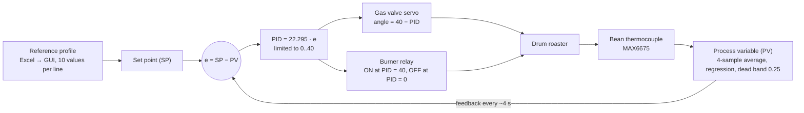
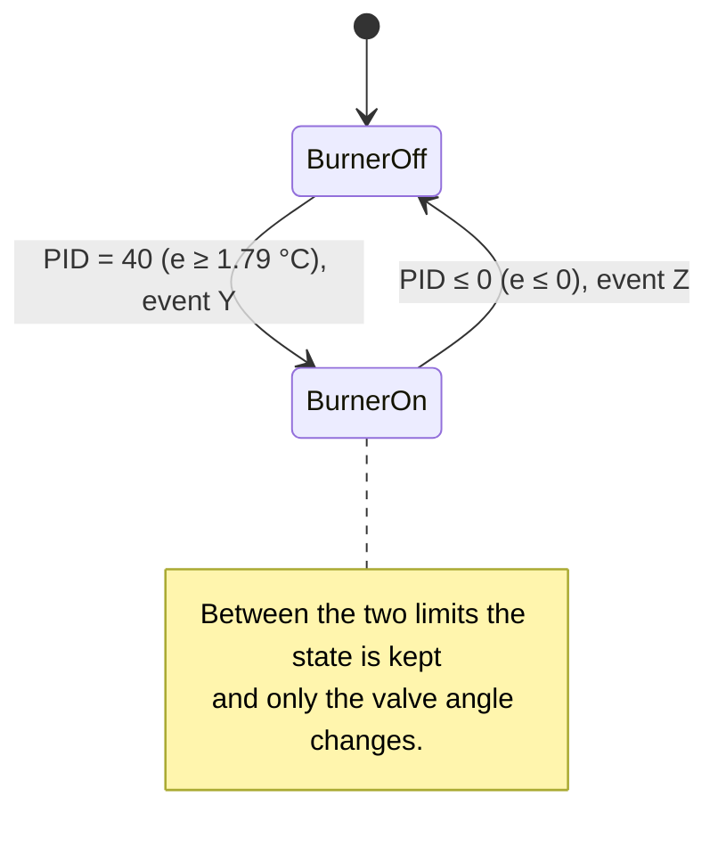

# Coffee Roasto v2.0

[Bahasa Indonesia](README.id.md)

**New generation of GUI for Monitoring Temperature Regulation System on Coffee Roaster Machine.**

Coffee Roasto is a capstone project that automates a drum coffee roaster. An Arduino reads two thermocouples and drives the burner, drum motor, blower, cooler and gas valve; a Windows desktop app shows the temperatures live, records them, and runs roasting automatically with a PID controller that follows a reference temperature profile. Version 2.0 is a new Fluent-style app on .NET 10.

> Status: the app and the Arduino firmware are built and tested without a roaster (see [testing](docs/en/testing.md)). Run the checklist in the [deployment guide](docs/en/deployment.md) with the burner disconnected before the first real roast.

## Highlights
- Fluent design (WPF-UI): cards, Mica backdrop on Windows 11, **light and dark theme** with one click
- Live chart (ScottPlot) of bean, drum and reference temperature with a mm:ss axis, zoom and pan
- Reading tiles: bean, drum, reference, **bean − reference**, **rate of rise (°C/min)** and elapsed time
- Manual control of burner, drum motor, blower, cooler and gas valve with lamps that show the state
- Heating mode: pre-heats the drum to 150 °C for 10 minutes
- PID mode: follows a reference profile loaded from an Excel file (bean temperature per step)
- Safety stop at 250 °C and a "roasting finished" toast from the hardware
- Record a session and export it to `.xlsx` (Excel does not have to be installed)
- One self-contained `.exe`, no .NET and no installer needed on the roaster PC

## Tech stack
C# · .NET 10 · WPF · WPF-UI (Fluent) · ScottPlot 5 · CommunityToolkit.Mvvm · ClosedXML · ExcelDataReader ·
xUnit · Arduino (C++) · MAX6675 thermocouple amplifiers · Servo · USB serial (9600 baud)

## Documentation
- [Requirements (as built)](docs/en/PRD.md)
- [System design](docs/en/system-design.md)
- [Architecture decisions](docs/en/adr/)
- [Serial protocol](docs/en/serial-protocol.md)
- [Hardware guide](docs/en/hardware.md)
- [Technical Q&A](docs/en/technical-qa.md)
- [Testing and demo](docs/en/testing.md)
- [Build, install and operate](docs/en/deployment.md)
- [Changelog](CHANGELOG.md)
- Diagrams (Mermaid): [`docs/en/diagrams/`](docs/en/diagrams/)

## Repository layout
| Path | What it holds |
| --- | --- |
| `src/CoffeeRoasto.Core/` | The logic without a screen: serial link, line parser, profiles, recording, Excel export |
| `src/CoffeeRoasto.App/` | The WPF app: window, view model, controls |
| `firmware/Program_PID_CP/` | The firmware that runs on the roaster (tabs: config, actuators, sensors, PID, modes) |
| `firmware/Pengujian_Hardware/` | Relay test sketch |
| `firmware/moveServo/` | Unfinished servo ramp sketch (does not compile, see limitations) |
| `tests/CoffeeRoasto.Tests/` | xUnit tests for `Core` and the view model |
| `tests/firmware-sim/` | The firmware run on the PC, with golden traces of the original firmware |
| `tools/screenshots/` | Replays a roast through the real window and saves the screenshots |
| `profiles/` | Sample reference temperature profiles (`.xls`, `.xlsx`) |
| `installer/` | `publish.ps1` for the single-file `.exe`; the v1.0 ClickOnce installer in `v1-clickonce/` |
| `check.ps1` | Restore, build, tests and firmware simulation in one command |

## Demo
The pictures come from the real window, replaying a whole 29-minute roast that the firmware simulation produced (see [testing and demo](docs/en/testing.md)).


<table>
<tr><td align="center" valign="top"><br><sub>PID mode after 15 minutes: the bean temperature follows the reference</sub></td><td align="center" valign="top"><br><sub>Dark theme, with a toast when the roast is finished</sub></td></tr>
<tr><td align="center" valign="top"><br><sub>A reference profile loaded from Excel</sub></td><td align="center" valign="top"><br><sub>Start screen, everything off until Connect</sub></td></tr>
</table>

## Getting started
Requirements: Windows 10 (1607) or newer, 64-bit. To build: the .NET 10 SDK. For the firmware: the Arduino IDE with the `MAX6675 library`.

```text
1. Flash firmware/Program_PID_CP/Program_PID_CP.ino to the board (Arduino IDE; install "MAX6675 library").
2. Run the app:    dotnet run --project src/CoffeeRoasto.App -c Release
   or publish it:  ./installer/publish.ps1   ->  installer/dist/CoffeeRoasto.exe (about 74 MB, self-contained)
3. Plug the board in, start Coffee Roasto, choose the COM port and press Connect.
```

| Action | What it does |
| --- | --- |
| Connect / Disconnect | Opens or closes the serial port at 9600 baud; the control cards stay disabled until connected |
| Burner, Drum motor, Blower, Cooler, Gas valve | Manual ON/OFF (valve: OPEN/CLOSE); the lamp lights when on |
| Heating mode ON/OFF | Pre-heat to 150 °C for 600 s with drum motor and blower on |
| PID mode ON | Starts the PID loop with a 150 °C set point until a profile is sent |
| Browse, sheet, Send profile | Loads the `beantemperature` column of an Excel sheet and sends it to the board in groups of 10 |
| Set point + Send | Gives the PID a single reference temperature by hand |
| Start / Stop / Export | Collects readings into the data card and exports them to `.xlsx` |
| Dark / Light | Switches the theme of the window and the chart |

Everything that can be checked without a roaster runs with `./check.ps1` (restore, build, 32 tests, firmware simulation).

## PID control (firmware)
The PID runs on the Arduino, not in the app (ADR-002). Code: `firmware/Program_PID_CP/` (`Pid.ino`, `PidMode.ino`, `Actuators.ino`, `ReferenceProfile.h`, `Config.h`).

### Control loop


| Element | In this project |
| --- | --- |
| Process | Drum coffee roaster with a gas burner |
| Process variable (PV) | Bean temperature, MAX6675 K-type thermocouple |
| Set point (SP) | The reference profile from Excel, sent by the GUI ten values at a time; 150 °C before a profile arrives; 0 ends the roast |
| Actuators | Gas valve servo (0° open, 40° closed) and the burner relay (active LOW) |
| Sampling period | One update every ~4 s (1 s samples, 4 averaged) |

### The calculation (`computePid`)
```text
e   = SP - PV
P   = KP * e                 KP = 21.095
I   = KI * (e + e_prev)      KI = 0.2
D   = e - e_prev
PID = P + I + D, limited to 0..40
```
The gains come from a MATLAB simulation. `e_prev` is a constant 0 and `KD` (30 in the simulation) is not used, so in practice
**PID = (KP + KI + 1) * e = 22.295 * e**: a proportional controller with one combined gain, not a true integral or derivative
(system design, known limitation 1). The code was kept exactly as in the original sketch; the refactor was checked against it
with golden traces.

### From the PID value to the actuators
- **Valve:** `servo = 40 - PID`. A large error gives PID = 40 and the valve at 0° (open, gas flows); an error of 0 or less gives 40° (closed). Confirmed on the machine.
- **Burner relay:** switched on only when PID reaches 40 (error of about 1.79 °C or more) and off when PID reaches 0 (bean at or above the set point). In between it keeps its state and only the valve moves, which stops the relay from chattering.
- **In practice:** a proportional band of only about 1.8 °C, so the loop behaves close to on/off with a little modulation near the set point.


The chart is drawn from the constants in `Config.h` by `tools/pid-charts/make_charts.py` (`python tools/pid-charts/make_charts.py`); rerun it if the gains change. It shows the formula, not a measured roast.



### Set point handling
`ReferenceProfile` keeps two buffers (*pending* and *active*). One set point is used per averaged reading (~4 s), so ten values
last about 40 s. A new line never overwrites values still being followed; if no new line arrives, the active group is reused.

### Safety rules around the loop
`s` from the GUI stops PID mode and turns the burner off. A bean temperature of 250 °C or more stops it by itself. A set point of 0
ends the roast (burner and blower off, drum on, cooler on). Because the loop is on the board, these still work if the PC hangs.

### Conclusion: why PID, and its strengths and weaknesses
**Why PID.** The goal (PRD) is to make the bean temperature follow a reference profile automatically. That is a set point tracking
problem with one measured output and one adjustable heat input, which is the standard use of a PID controller. It needs no
detailed model of the roaster, it is simple enough to run on an AVR with a 4 s period, and the team could simulate and tune it in
MATLAB first. Running it on the Arduino keeps the control period steady and the safety rules independent of the PC (ADR-002). The
repository records the decision to put the loop on the board (ADR-002) and the MATLAB origin of the gains; it does not contain a
separate record comparing PID with other control methods, so the reasons above are the engineering rationale, not a quoted decision.

| Strengths | Weaknesses |
| --- | --- |
| Follows a changing profile, not only one fixed temperature | The implemented I and D terms are not real: no accumulated error, no rate of change, so no removal of steady-state error and no damping |
| Light on resources: a few float operations per 4 s | Narrow proportional band (about 1.8 °C), so it acts almost like on/off and may oscillate around the set point |
| Closed loop: it reacts to the measured bean temperature, not to a timer | The MATLAB gains are not fully applied, so behaviour differs from the simulation |
| Output limit (0..40) matches the servo range | No anti-windup or rate limit, and a 4 s sample period is slow against the thermal delay of the drum |
| Safety (250 °C stop, `s`) lives on the board | Tuning means re-flashing; the GUI cannot change the gains (out of scope in the PRD) |
| Burner switching has hysteresis, so the relay does not chatter | No watchdog: if the cable is pulled the board keeps its last mode |

The weaknesses about oscillation and steady-state offset follow from reading the code; they have not been measured on a real roast yet.
To get a real PID: keep `previousError`, add an integral accumulator with anti-windup, use `KD` with the 4 s period, and re-tune on
the machine. That changes how a gas burner is controlled, so test it with the burner disconnected first and update the golden traces.

## Safety
The firmware turns the burner off and stops at 250 °C, but the gas burner, the hot drum and the moving parts are real hazards. Never leave a roast unattended; test changes with the burner disconnected first.
