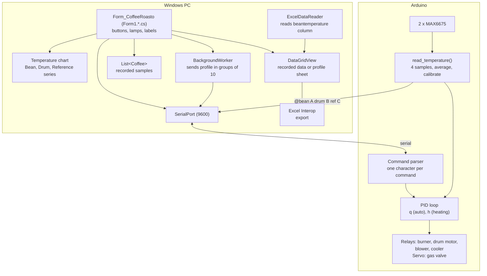
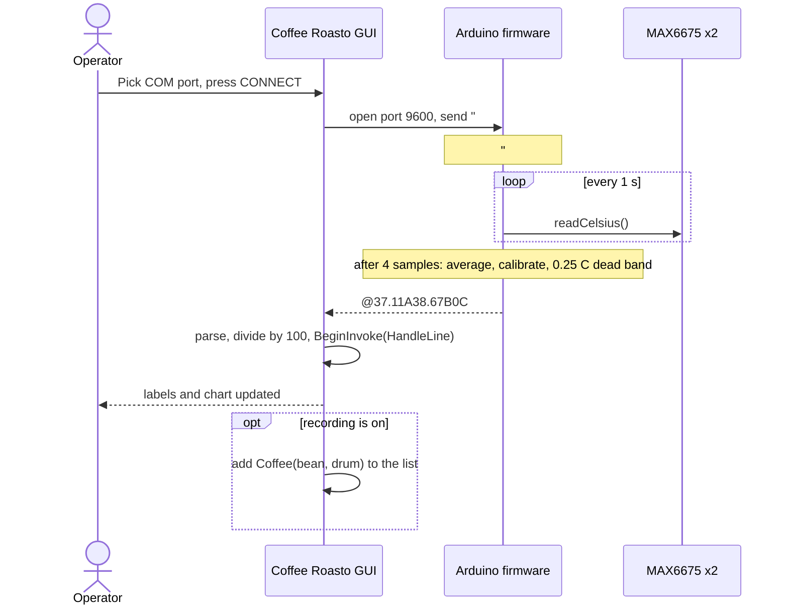
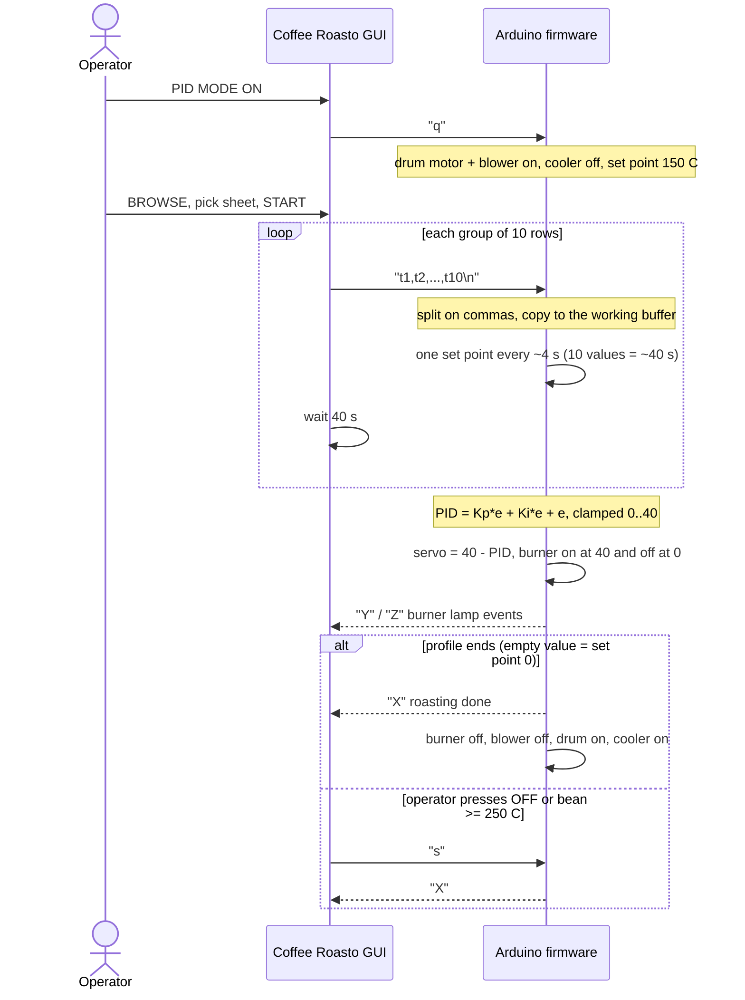
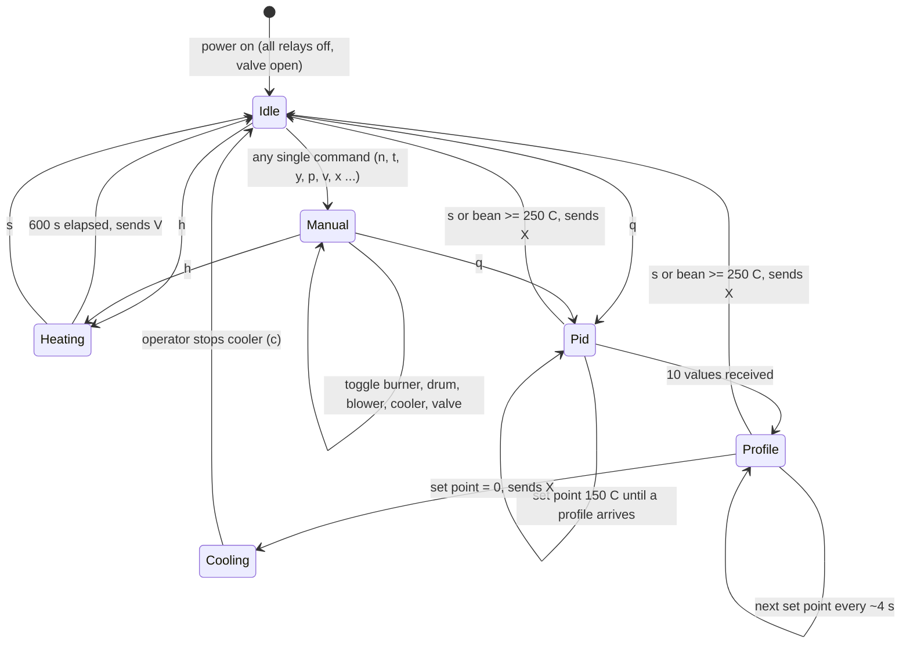

# Coffee Roasto System Design

Nov 9, 2026 · @M Ridhwan Habib A

Coffee Roasto has two programs: a Windows Forms desktop app and an Arduino firmware, connected by a USB serial cable. The firmware owns the real-time control loop; the app supervises, plots and records. This document describes the system as built, from the code in the repository.

## 1. Scope & quality goals

The design targets one roaster, one operator at a time, on a Windows PC next to the machine.

| Quality goal | Target | Design response |
| --- | --- | --- |
| Safety | Burner never stays on after a stop or an over-temperature | Relays idle off, `s` command, hard stop at 250 °C in firmware |
| Control quality | Bean temperature follows the profile | PID on the board, set point updated every ~4 s |
| Responsiveness | New reading shown within a second of arriving | Serial event + `BeginInvoke` to the UI thread |
| Robustness | App never crashes on a bad frame or an unplugged cable | `try/catch` around parsing and serial writes |
| Simplicity | Operator needs no setup beyond the COM port | One screen, one button per action |
| Maintainability | Both sides readable by students | Single-character protocol, one `Form1.cs`, one `.ino` |

**Architecture style:** supervisory GUI plus embedded controller. The controller does not depend on the PC to stay safe once a mode is running, apart from the `s` command and the profile feed.

## 2. System context

## 3. Components

The GUI is one screen (`Form_CoffeeRoasto`, split over several partial files) and a handful of small classes with one job each. Only `UI/` knows the screen, so `Hardware/` and `Profiles/` can be read and tested alone.

| Folder / file | Class | Responsibility |
| --- | --- | --- |
| `Form1.cs` | `Form_CoffeeRoasto` | Builds the helper objects, handles incoming lines (telemetry and events) |
| `Form1.Connection.cs` | (partial) | COM port list, connect, disconnect, enable or disable the controls |
| `Form1.Manual.cs` | (partial) | Burner, drum motor, blower, cooler, valve buttons; manual set point |
| `Form1.Modes.cs` | (partial) | Heating, auto and PID start/stop and their lamps |
| `Form1.Recording.cs` | (partial) | Record start/stop, export |
| `Form1.Profile.cs` | (partial) | Browse a profile, choose a sheet, send it |
| `Form1.Designer.cs` | (generated) | Controls and event wiring made by the Visual Studio designer |
| `Hardware/RoasterCommand.cs` | `RoasterCommand` | The command characters, one constant each |
| `Hardware/RoasterLink.cs` | `RoasterLink` | Serial port: open (9600 baud), close, send, read a line |
| `Hardware/FrameParser.cs`, `ParsedLine.cs` | `FrameParser`, `ParsedLine`, `Telemetry`, `RoasterEvent` | Turns a received line into a reading or an event (pure logic) |
| `Profiles/ProfileReader.cs` | `ProfileReader` | Reads the `beantemperature` column of every Excel sheet |
| `Profiles/ProfileTransmitter.cs` | `ProfileTransmitter` | Sends a profile in groups of ten, 40 s apart, on a background thread |
| `Recording/RecordingSession.cs`, `Coffee.cs` | `RecordingSession`, `Coffee` | The samples collected while recording |
| `Recording/ExcelExporter.cs` | `ExcelExporter` | Copies the data grid to a new Excel workbook |
| `UI/LampBoard.cs` | `LampBoard`, `Lamp` | All pilot lamps by name: `On(...)`, `Off(...)`, `AllOff()` |
| `UI/PilotLamp.cs` | `PilotLamp` | Round `Button`; `BackColor` is the lamp colour (dark green = off, lime = on) |
| `UI/TemperatureChart.cs` | `TemperatureChart` | The chart and its three series |
| `UI/RoastClock.cs` | `RoastClock` | The time axis (mm:ss since connect or mode start) |
| `Program.cs` | `Program` | Entry point |
| firmware `Program_PID_CP.ino` | | Command parser, PID, relay and servo outputs |
| firmware `read_temperature.ino` | | Thermocouple reading, averaging, calibration, data frame |
| firmware `pisahkansuhuref.ino` | | Splits a comma-separated profile line |

Dependencies point one way: `Form1.*` uses `Hardware`, `Profiles`, `Recording` and `UI`; `Profiles` uses `Hardware`. `Hardware`, `Profiles` and `Recording` do not reference the form.

## 4. Runtime view

### Telemetry

### Automatic roasting with a profile

## 5. Modes

## 6. Control loop

- **Sampling:** every 1 s one reading per sensor; four readings are averaged, so a new frame appears every ~4 s.
- **Calibration:** linear regression per sensor, then a 0.25 °C dead band (see [hardware guide](hardware.md)).
- **PID:** `e = set point − bean`; `PID = 21.095·e + 0.2·(e + e_prev) + (e − e_prev)`, clamped to 0–40. The same number drives the valve (`servo = 40 − PID`, so a large error closes the valve toward the burner) and the burner relay (on at 40, off at 0).
- **Set points:** 150 °C until a profile arrives, then one value per sample, then `0` to end.
- **Limits:** bean ≥ 250 °C stops PID mode; heating mode runs 600 s.

## 7. Data

| Data | Where | Form |
| --- | --- | --- |
| Latest bean, drum, reference temperature | `beantemperature`, `drumtemperature`, `referencetemperature` in the form | `double`, °C |
| Recording | `List<Coffee>` → `dataGridView` | In memory, cleared by START; lost on close unless exported |
| Profile | `DataSet` from ExcelDataReader | Only the column whose header is `beantemperature`; one table per sheet |
| Export | New Excel workbook, sheet "Exported from gridview" | Header row + one row per record |
| Sample files | `profiles/` | `.xls`, `.xlsx` profiles |

There is no database and no network access.

## 8. Threading

The serial `DataReceived` event runs on a pool thread and calls `RoasterLink.TryReadLine`; the line is then handed to `HandleLine` on the UI thread with `BeginInvoke`. Profile sending runs on a `BackgroundWorker` and sleeps 40 s between groups, so the UI stays responsive. Parsing results, lamps, labels, the chart and message boxes are all handled on the UI thread.

## 9. Build & distribution

Visual Studio solution `CoffeeRoasto_GUI.sln`, target .NET Framework 4.7.2, output type WinExe. NuGet packages: ExcelDataReader 3.6.0, ExcelDataReader.DataSet 3.6.0, Microsoft.Office.Interop.Excel 15.0.4795.1000, System.Runtime.Extensions 4.3.1. Published with ClickOnce (`setup.exe`, `CoffeeRoasto_GUI.application`, `autorun.inf` for a CD or USB stick). See the [deployment guide](deployment.md).

## 10. Known limitations

These are the points where the code and the intent differ. They are listed so nobody is surprised; none is changed by this documentation.

| # | Area | Observation | Effect |
| --- | --- | --- | --- |
| 1 | Firmware PID | `errorx` is never updated and `kd` (30) is never used; the integral is `ki·e` and the derivative term is `e` | Behaves as P + small I + extra P; the MATLAB gains are not fully applied |
| 2 | GUI parsing | `Convert.ToDouble(...) / 100` depends on the PC culture | Wrong values on an English-culture PC |
| 3 | Auto mode `m` | The GUI sends `m` but the firmware has no handler | AUTO MODE ON does nothing useful; use PID MODE |
| 4 | Serial framing | GUI `Write("n")` has no newline, firmware waits for `\n` | Commands arrive after the 1 s `readStringUntil` timeout |
| 5 | Threading | ~~`Data_Parsing` changed lamps on the serial thread~~ **Fixed**: lines are handled on the UI thread | none |
| 6 | Burner ON button | ~~wrote without the `IsOpen` check~~ **Fixed**: every command goes through `RoasterLink.Send` | none |
| 7 | Heating OFF | `button_StopHeatingMode_Click` shows "Roasting Selesai" before sending `s` | Misleading message |
| 8 | Profile sending | Blocks 40 s between groups and cannot be cancelled from the UI | Must press OFF (`s`) to abort |
| 9 | `moveServo.ino` | Does not compile | Not used by the firmware |
| 10 | Repository | `bin/`, `obj/`, `.vs/`, `packages/`, `Release.rar` and a signing key are in the tree | Large repository; keep out of version control |
| 11 | Export | `Excel Interop` needs Excel installed (the skipped last row is **fixed**) | Fails on a PC without Excel |
