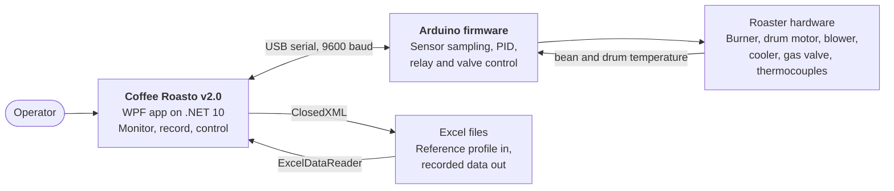
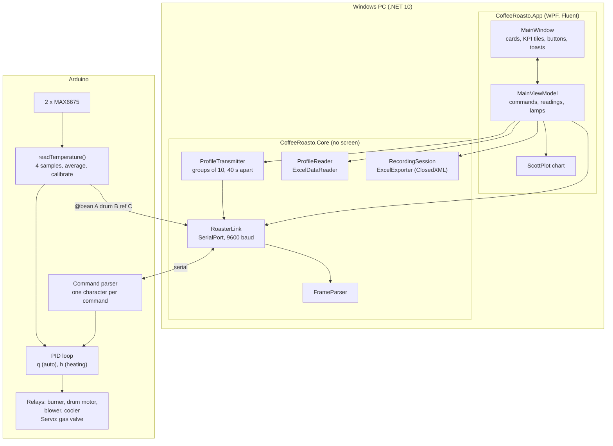
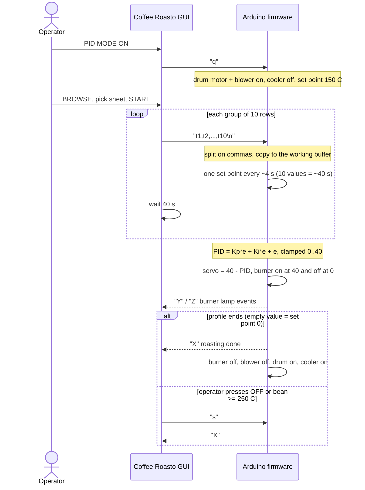
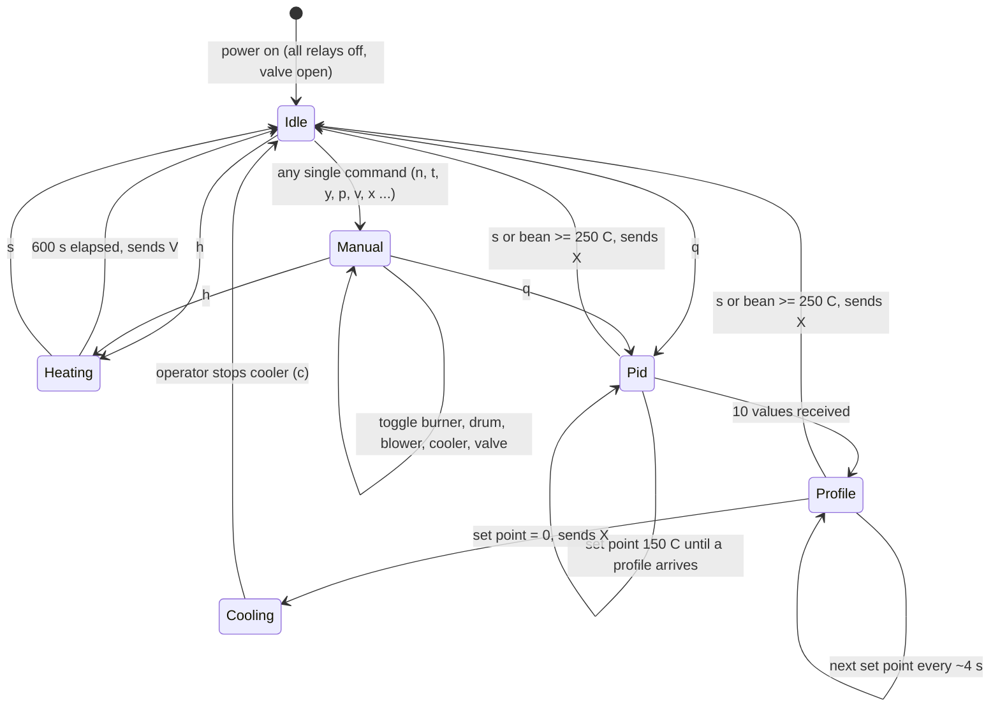

# Coffee Roasto System Design

Nov 9, 2026 · @M Ridhwan Habib A

Coffee Roasto v2.0 has two programs: a WPF desktop app on .NET 10 and an Arduino firmware, connected by a USB serial cable. The firmware owns the real-time control loop; the app supervises, plots and records. This document describes the system as built, from the code in the repository.

## 1. Scope & quality goals

The design targets one roaster, one operator at a time, on a Windows PC next to the machine.

| Quality goal | Target | Design response |
| --- | --- | --- |
| Safety | Burner never stays on after a stop or an over-temperature | Relays idle off, `s` command, hard stop at 250 °C in firmware |
| Control quality | Bean temperature follows the profile | PID on the board, set point updated every ~4 s |
| Responsiveness | New reading shown within a second of arriving | Serial event, then `Dispatcher.BeginInvoke` to the UI thread |
| Robustness | App never crashes on a bad frame or an unplugged cable | `try/catch` around parsing and serial writes |
| Simplicity | Operator needs no setup beyond the COM port | One window, one button per action, one `.exe` without installer |
| Maintainability | Both sides readable by students | Single-character protocol; `Core` without a screen, a view model, a thin window; one small tab per job in the firmware |

**Architecture style:** supervisory GUI plus embedded controller. The controller does not depend on the PC to stay safe once a mode is running, apart from the `s` command and the profile feed.

## 2. System context



## 3. Components

The app is a WPF window on top of a library that has no screen. The view model is the only thing the window talks to; `Core` can be read and tested alone.



| Folder / file | Class | Responsibility |
| --- | --- | --- |
| `src/CoffeeRoasto.Core/Hardware/RoasterCommand.cs` | `RoasterCommand` | The command characters, one constant each |
| `Hardware/RoasterLink.cs` | `RoasterLink` | Serial port (9600 baud): open, close, send, the `LineReceived` event |
| `Hardware/FrameParser.cs`, `ParsedLine.cs` | `FrameParser`, `ParsedLine`, `Telemetry`, `RoasterEvent` | Turns a received line into a reading or an event; invariant culture; pure logic |
| `Profiles/ProfileReader.cs` | `ProfileReader` | Reads the `beantemperature` column of every sheet of an `.xls` or `.xlsx` file |
| `Profiles/ProfileTransmitter.cs` | `ProfileTransmitter` | Sends a profile in groups of ten, 40 s apart, as a background task |
| `Recording/RecordingSession.cs` | `RecordingSession`, `Coffee` | The samples collected while recording |
| `Recording/ExcelExporter.cs` | `ExcelExporter` | Writes a recording to an `.xlsx` file with ClosedXML; Excel does not have to be installed |
| `src/CoffeeRoasto.App/ViewModels/MainViewModel.cs` | `MainViewModel` | Everything the window shows (readings, delta, rate of rise, lamps, table) and every command behind a button |
| `ViewModels/TemperatureHistory.cs` | `TemperatureHistory` | The points of the chart; raises `Changed` |
| `MainWindow.xaml`, `.xaml.cs` | `MainWindow` | The Fluent window (WPF-UI): layout, light and dark theme, ScottPlot chart, file dialogs, toasts |
| `Controls/LampIndicator.xaml`, `KpiTile.xaml` | `LampIndicator`, `KpiTile` | The round lamp with a halo and the card with one reading |
| `App.xaml`, `App.xaml.cs` | `App` | Start-up, the Fluent theme dictionaries, the colours of the three lines |
| firmware `Program_PID_CP.ino` | | `setup()` and `loop()`: read a command, read the sensors, dispatch to a mode |
| firmware `Config.h`, `Commands.h`, `Globals.h` | | Pins and limits, protocol characters, shared objects |
| firmware `Actuators.ino` | | Relays, valve servo, burner switching by PID output |
| firmware `TemperatureSensors.ino` | | Sampling, averaging, calibration, dead band, the data frame |
| firmware `Pid.ino` | | The PID calculation |
| firmware `ReferenceProfile.h` | `ReferenceProfile` | Pending and active groups of ten set points |
| firmware `ManualMode.ino` | | One command per output, typed set point, manual burner hold |
| firmware `PidMode.ino`, `HeatingMode.ino` | | The two loops that run until done, stopped or over-temperature |

Dependencies point one way: `MainWindow` uses `MainViewModel`; the view model uses `Core`; `Core` does not know the window. The tests and the screenshot tool use the view model without a window.

## 4. Runtime view

### Telemetry
```mermaid
%% Source: diagrams/sequences/telemetry.mmd
sequenceDiagram
  actor Op as Operator
  participant UI as MainWindow
  participant VM as MainViewModel
  participant Link as RoasterLink
  participant FW as Arduino firmware

  Op->>UI: Choose a COM port, press Connect
  UI->>VM: ConnectCommand
  VM->>Link: Open(port) and send "#"
  Note over FW: "#" is not a command, so it is read as set point 0 (clears old state)
  loop every ~4 s (4 samples of 1 s, averaged)
    FW-->>Link: @37.11A38.67B0C
    Link-->>VM: LineReceived (serial thread)
    VM->>VM: Post to the UI thread, FrameParser.Parse (invariant culture)
    VM-->>UI: readings, delta, rate of rise, elapsed
    VM-->>UI: History.Changed, the chart is redrawn
  end
  opt recording is on
    VM->>VM: RecordingSession.Add(bean, drum, reference, seconds)
  end
```

### Automatic roasting with a profile


## 5. Modes



## 6. Control loop

- **Sampling:** every 1 s one reading per sensor; four readings are averaged, so a new frame appears every ~4 s.
- **Calibration:** linear regression per sensor, then a 0.25 °C dead band (see [hardware guide](hardware.md)).
- **PID:** `e = set point − bean`; `PID = 21.095·e + 0.2·(e + e_prev) + (e − e_prev)`, clamped to 0–40. The same number drives the valve (`servo = 40 − PID`, so a large error closes the valve toward the burner) and the burner relay (on at 40, off at 0).
- **Set points:** 150 °C until a profile arrives, then one value per sample, then `0` to end.
- **Limits:** bean ≥ 250 °C stops PID mode; heating mode runs 600 s.

## 7. Data

| Data | Where | Form |
| --- | --- | --- |
| Latest readings | `BeanText`, `DrumText`, `ReferenceText`, `DeltaText`, `RateText`, `ElapsedText` of the view model | Text, °C, one decimal |
| Chart points | `TemperatureHistory` | Four lists of `double`: seconds, bean, drum, reference |
| Recording | `RecordingSession.Samples` | In memory, cleared by START; lost on close unless exported |
| Profile | `DataTableCollection` from ExcelDataReader | Only the column whose header is `beantemperature`; one table per sheet |
| Export | New `.xlsx`, sheet "Roast" | Header row + one row per sample: time, bean, drum, reference |
| Sample files | `profiles/` | `.xls`, `.xlsx` profiles |

There is no database and no network access.

## 8. Threading

`SerialPort.DataReceived` runs on a pool thread. `RoasterLink` reads the lines there and raises `LineReceived`; the view model hands each line to the UI thread (`Post`, by default `Dispatcher.BeginInvoke`) and only then parses it and updates the screen. Profile sending is a background `Task` that waits 40 s between groups. The clock of the screen is a `DispatcherTimer` of one second. Everything the window binds to changes on the UI thread only.

## 9. Build & distribution

`CoffeeRoasto.slnx` holds four projects: `CoffeeRoasto.Core` (net10.0), `CoffeeRoasto.App` (net10.0-windows, WPF), `CoffeeRoasto.Tests` (xUnit) and `tools/screenshots`. Packages (all MIT, BSD or Apache): WPF-UI, ScottPlot.WPF, CommunityToolkit.Mvvm, ClosedXML, ExcelDataReader (+ DataSet), System.IO.Ports, xUnit. `installer/publish.ps1` makes one self-contained, single-file `CoffeeRoasto.exe` (about 74 MB) that needs no .NET on the PC. The ClickOnce installer of v1.0 is kept in `installer/v1-clickonce/`. See the [deployment guide](deployment.md).

## 10. Known limitations

These are the points where the code and the intent differ. They are listed so nobody is surprised.

| # | Area | Observation | Effect |
| --- | --- | --- | --- |
| 1 | Firmware PID | `PREVIOUS_ERROR` stays 0 and `KD` (30) is never used; the integral is `KI·e` and the derivative term is `e` | Behaves as P + small I + extra P; the MATLAB gains are not fully applied |
| 2 | App parsing | ~~`Convert.ToDouble(...) / 100` depended on the PC culture~~ **Fixed in v2.0**: values are read with the invariant culture | none |
| 3 | Auto mode `m` | The app sends `m` but the firmware has no handler | AUTO MODE ON does nothing useful; use PID MODE |
| 4 | Serial framing | The app writes a command without a newline, the firmware waits for `\n` | Commands arrive after the 1 s `readStringUntil` timeout |
| 5 | Threading | ~~Lamps were changed on the serial thread~~ **Fixed**: lines are handled on the UI thread | none |
| 6 | Burner ON button | ~~wrote without the `IsOpen` check~~ **Fixed**: every command goes through `RoasterLink.Send` | none |
| 7 | Heating OFF | ~~showed "Roasting Selesai" before sending `s`~~ **Fixed in v2.0**: no message | none |
| 8 | Profile sending | Waits 40 s between groups and has no cancel button; OFF stops the firmware but the app keeps sending lines | Close the app or wait to abort the transfer |
| 9 | `moveServo.ino` | Does not compile | Not used by the firmware |
| 10 | Repository | ~~build output and a signing key were in the tree~~ **Fixed**: ignored by git, v1 files in `archive/` and `installer/v1-clickonce/` | none |
| 11 | Export | ~~needed Excel and skipped the last row~~ **Fixed in v2.0**: ClosedXML writes the `.xlsx`, every sample is exported | none |
| 12 | Profile end | With no new line the firmware reuses the last group of ten, and only an empty value ends the roast | A profile with a multiple of ten rows never ends by itself; press OFF or wait for 250 °C |
| 13 | Build | `dotnet build` that restores and builds the WPF project in one command can fail on a clean checkout | Run `dotnet restore` first, or use `check.ps1` |
