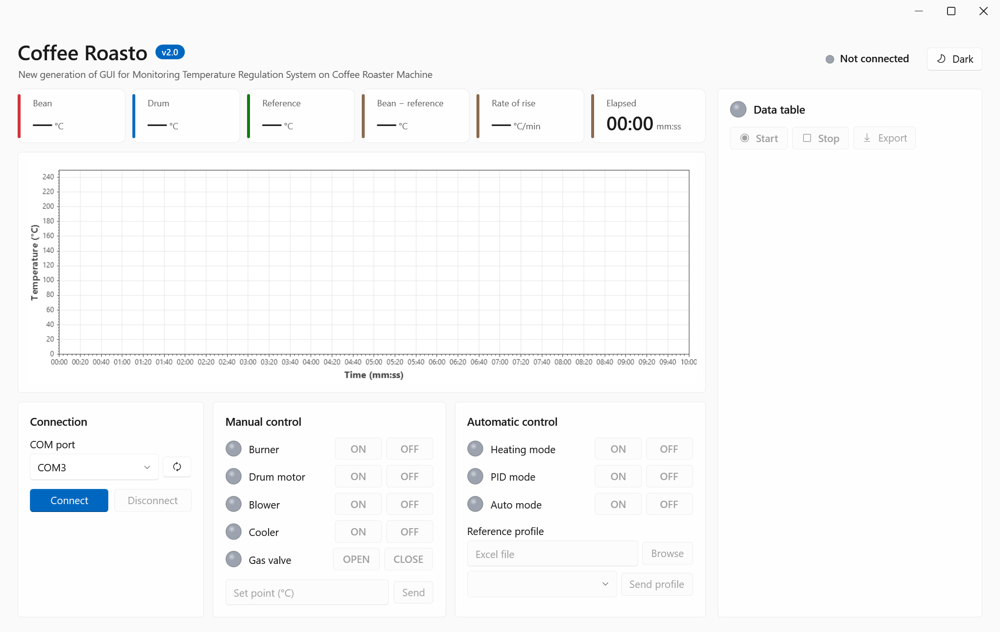
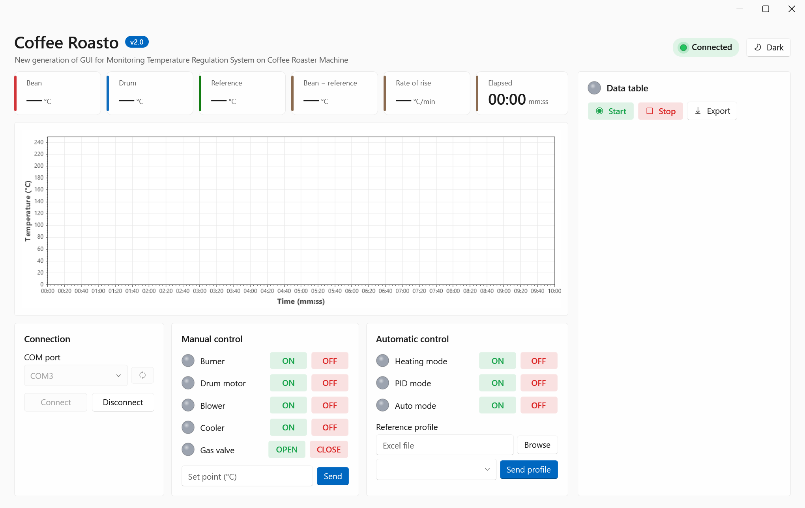
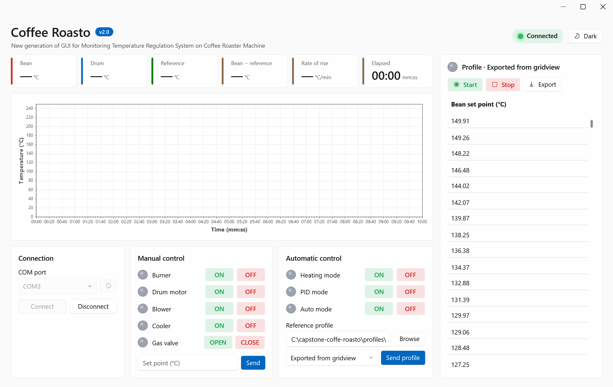
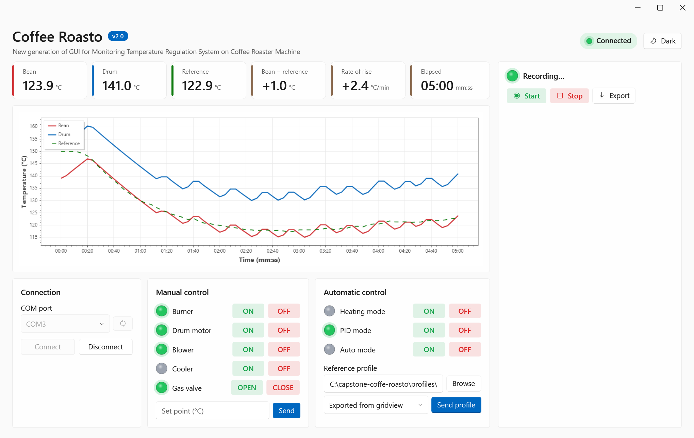
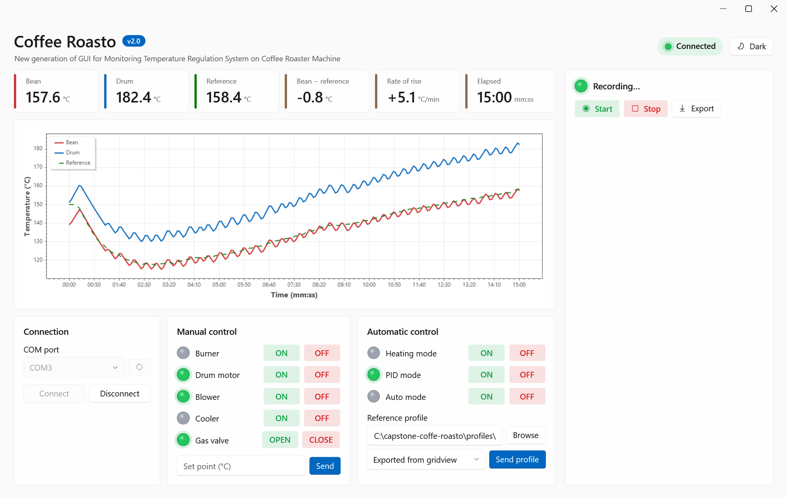
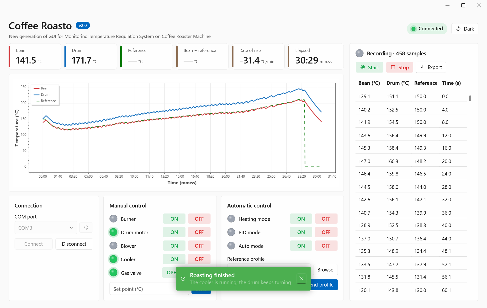
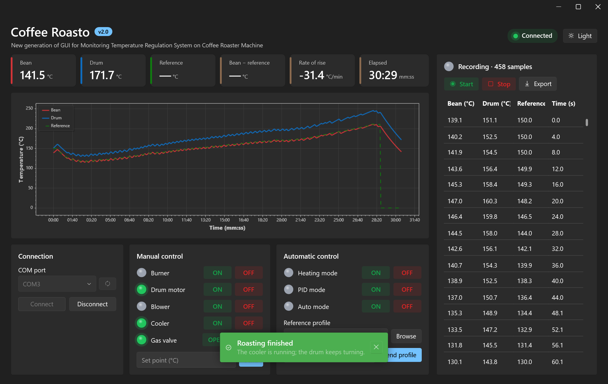
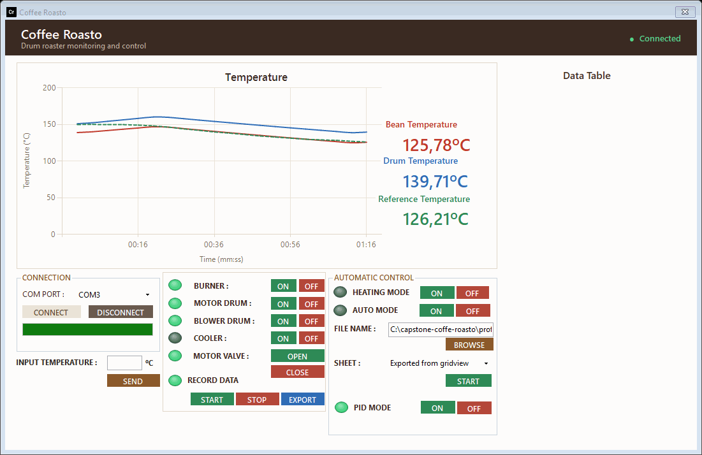

# Testing and demo

Nov 9, 2026 · @M Ridhwan Habib A

How Coffee Roasto v2.0 is tested without a roaster, what the tests prove and what they cannot. The same tools make the screenshots and the animation of the README, so the pictures show the real application.

## 1. What is tested

| Layer | Tool | What it checks | Result (Nov 9, 2026) |
| --- | --- | --- | --- |
| Core logic | `tests/CoffeeRoasto.Tests/Core` (xUnit) | `FrameParser` (also under three cultures), `ProfileTransmitter.BuildChunks` (compared with the v1 algorithm for 0–45 rows), `ProfileReader` on the real sample `.xlsx` and the old `.xls`, `RecordingSession`, the Excel export including its last row | pass |
| View model | `tests/CoffeeRoasto.Tests/ViewModels` (xUnit) | Readings, delta and rate of rise, lamps and toasts for the events, buttons with a closed port, refused input, recording | pass |
| Firmware | `tests/firmware-sim/run.ps1` | The sketch run on the PC against 12 scripted scenarios; pin changes, servo angles and serial lines are compared with `golden/` | 12 of 12 match |
| Compile | `dotnet build`, `arduino-cli compile --fqbn arduino:avr:uno` | No warnings; firmware flash 11,104 bytes (34 %), RAM 334 bytes (16 %) | pass |
| Published file | `installer/publish.ps1`, then starting the `.exe` | The single-file build starts and shows its window | pass |
| Screens | `tools/screenshots/run.ps1` | The real window and view model draw a whole roast in the light and the dark theme | 7 screenshots, 1 GIF |

32 xUnit tests in total. Raw outputs of the firmware simulation are in [`docs/assets/testing/`](../assets/testing/).

## 2. Firmware simulation

`tests/firmware-sim/harness.cpp` compiles the real sketch together with a small stand-in for the Arduino core (`shim/`: `String`, `Serial`, `millis`, `digitalWrite`, `Servo`, `MAX6675`). A virtual clock moves only when the firmware waits, so a 29-minute roast runs in under a second and gives the same result every time.

| # | Scenario | Ends with |
| --- | --- | --- |
| 1 | Every manual command, then a typed set point of 120 °C | `s` |
| 2 | Heating mode until the 600 s are over | `V` |
| 3 | Heating mode stopped by the operator | `s` |
| 4 | PID mode, bean temperature jumps above 250 °C | `X` (over-temperature) |
| 5 | PID mode, profile of two lines, the last one short | `X` (profile ended) |
| 6 | PID mode stopped by the operator | `X` |
| 7 | PID mode, a full group of ten that is reused until stopped | `X` after `s` |
| 8 | Typed set point, then PID mode | `X` after `s` |
| 9, 10, 11 | Temperature hovering around the set point, so the PID leaves its limits (heating, PID, manual) | by script |
| 12 | A whole roast: the recorded profile `Testing Baru.xls.xlsx` (427 rows) in a closed loop with a simple heating model | `X` at 28:42 |

**Where `golden/` comes from.** The traces were recorded from the *original* single-file firmware (commit `a5cca6b`), not from the refactored one. The refactored firmware reproduces them exactly, which is the evidence that the restructuring did not change behaviour. A deliberate mutation of the PID formula was detected by scenarios 9 and 10, so the comparison is sensitive.

**A detail of the comparison.** On the PC `double` has 64 bits and on the AVR it has 32 bits, the same as `float`. The golden traces were therefore recorded with the calibration constants written as `float` literals, as they behave on the board; with 64-bit constants one value in 1,268 lines differs in the second decimal.

Scenario 12 in numbers: 458 data frames, the bean temperature starts at 139 °C and follows the profile up to 210 °C (peak 211 °C), the burner is switched on 69 times, and after the first 3 minutes the bean temperature is on average 1.3 °C below the profile (between −5.6 and +1.9 °C). The heating model is a toy; these numbers describe the controller logic, not the real machine.

## 3. Screenshots and animation

`tools/screenshots/run.ps1` opens the real `MainWindow` with a real `MainViewModel` and replays scenario 12 through `HandleLine` as if the lines came from the serial port. Only the serial port is missing; the connected state and the lamps that the buttons would set are set directly. The time axis comes from `ElapsedProvider`, so it shows the 29 minutes without waiting. Output: `docs/assets/screenshots/` and `docs/assets/flows/pid-roast.gif`.

| | |
| --- | --- |
|  |  |
| 1. Start: everything off until Connect | 2. Connected: control cards on, COM port chosen |
|  |  |
| 3. A profile file and sheet loaded into the data card | 4. PID mode after 5 minutes |
|  |  |
| 5. After 15 minutes: bean follows the reference, delta and rate of rise on the tiles | 6. Roast finished: the recording is in the data card, a toast says so |
|  | |
| 7. The same screen in the dark theme | |



## 4. How to run

```powershell
./check.ps1                       # restore, build, all xUnit tests and the firmware simulation
./check.ps1 -Quick                # the same without the firmware simulation (no C++ build tools needed)
tests/firmware-sim/run.ps1        # only the firmware simulation (needs the Visual Studio C++ build tools)
tools/screenshots/run.ps1         # screenshots and GIF; the GIF needs Python with Pillow
```

After a deliberate change of firmware behaviour, run `tests/firmware-sim/run.ps1 -Update` and review the diff of `golden/` before committing it. Add a prototype to `tests/firmware-sim/prototypes.h` when a tab gets a new function.

## 5. What is not tested

- The real roaster: relays, the servo, the thermocouples, the gas valve and the thermal behaviour. Use the checklist in the [deployment guide](deployment.md) with the burner disconnected first.
- The serial link itself (cable, driver, timeouts). The simulation hands lines directly to the code.
- The Windows file dialogs and opening Excel after an export; the export file itself is read back and checked.
- The 1-second `readStringUntil` timeout that a command without a newline causes (known limitation 4); the simulation delivers whole lines.
- Mica and other Windows 11 window effects; the screenshots use a plain background.
