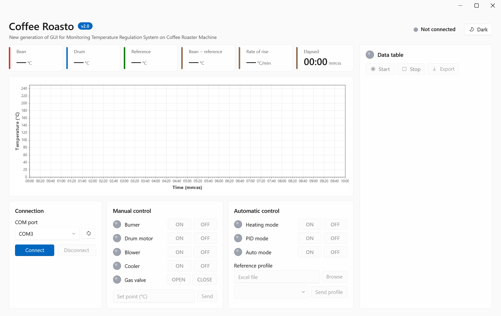
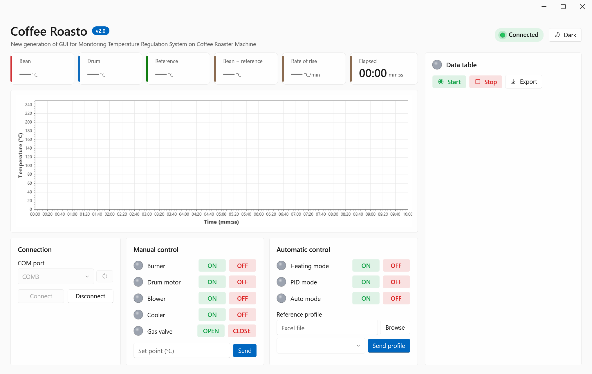
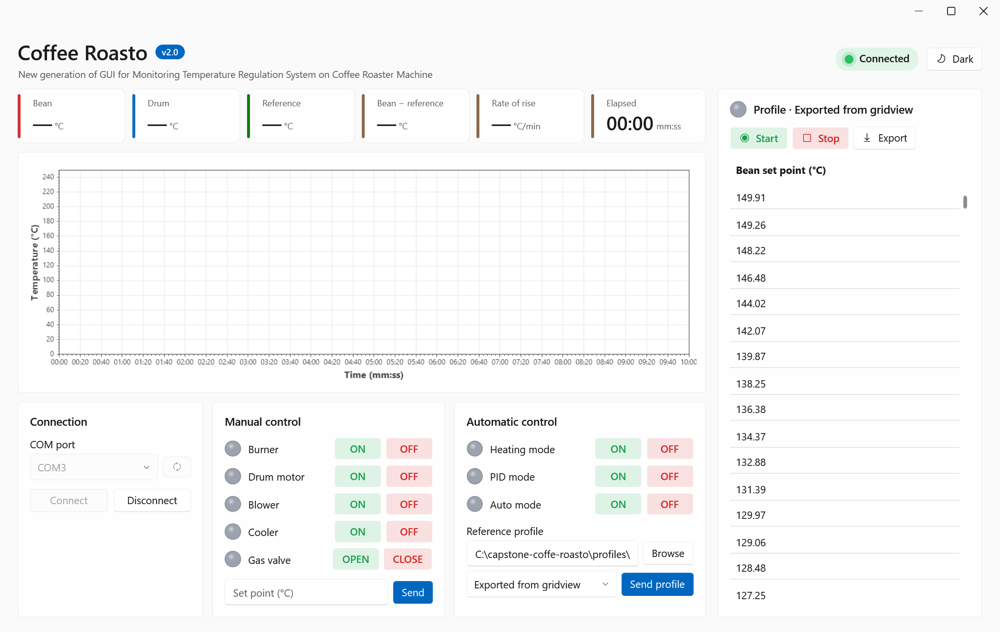
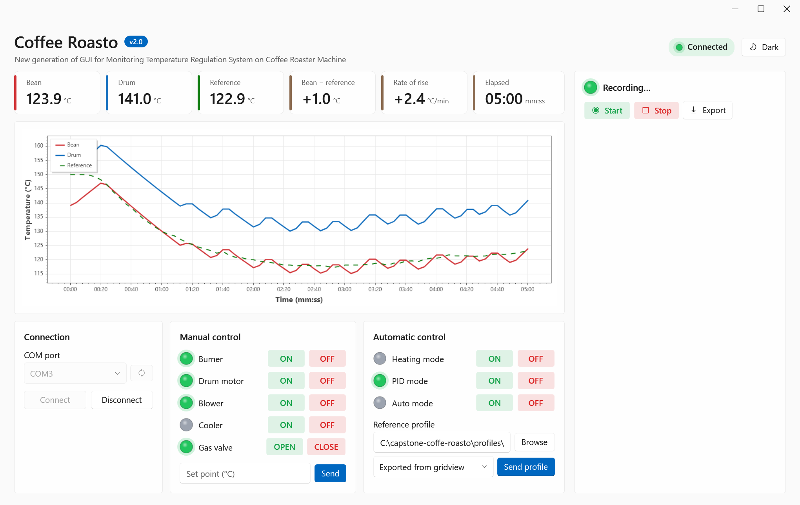
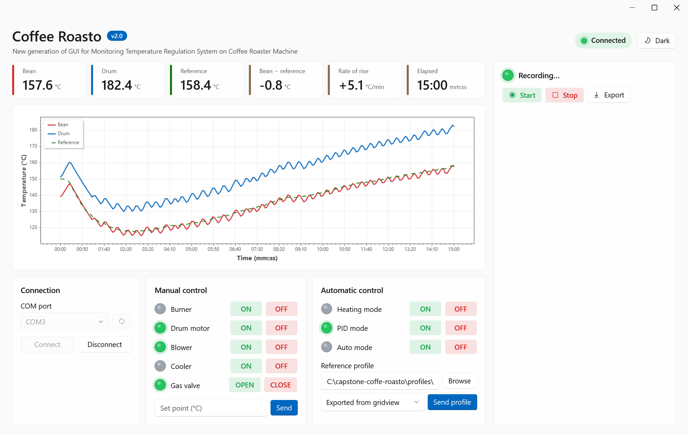
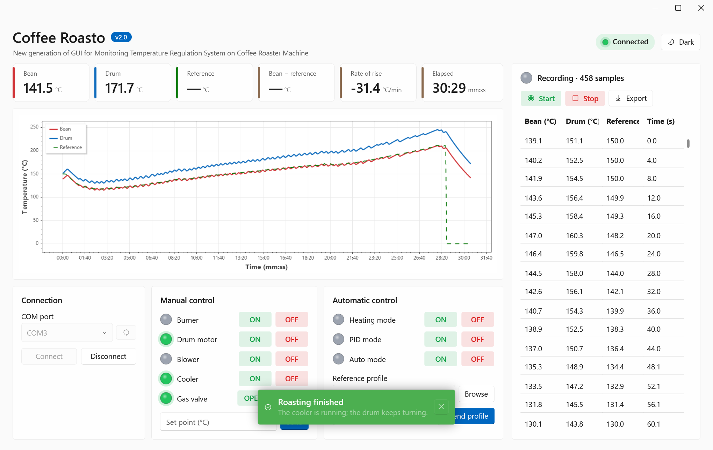
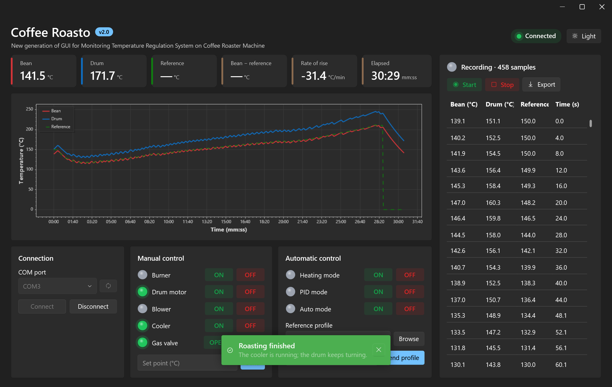
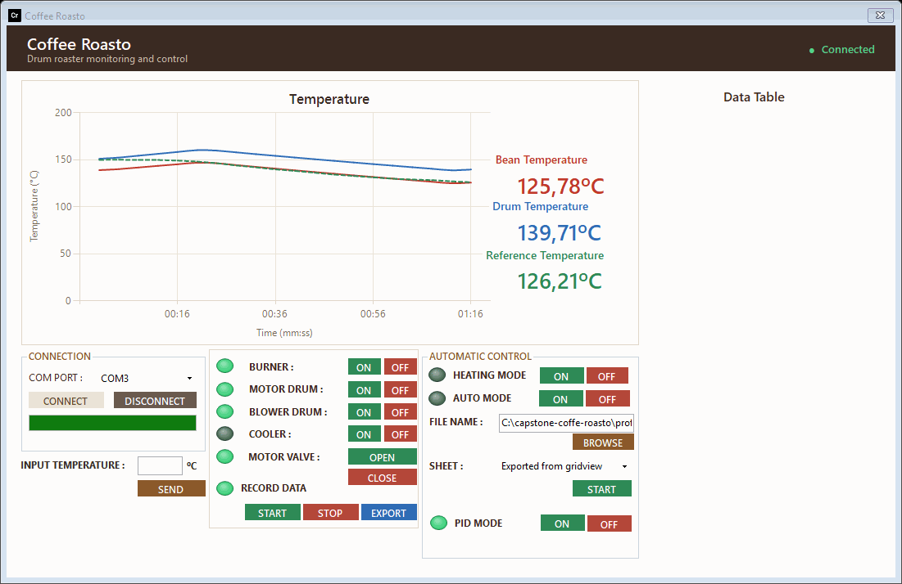

# Pengujian dan demo

9 Nov 2026 · @M Ridhwan Habib A

Cara Coffee Roasto v2.0 diuji tanpa mesin, apa yang dibuktikan pengujian, dan apa yang tidak bisa. Alat yang sama membuat screenshot dan animasi di README, jadi gambarnya adalah aplikasi yang sebenarnya.

## 1. Yang diuji

| Lapisan | Alat | Yang diperiksa | Hasil (9 Nov 2026) |
| --- | --- | --- | --- |
| Logika Core | `tests/CoffeeRoasto.Tests/Core` (xUnit) | `FrameParser` (juga di tiga culture), `ProfileTransmitter.BuildChunks` (dibandingkan dengan algoritma v1 untuk 0–45 baris), `ProfileReader` pada contoh `.xlsx` asli dan `.xls` lama, `RecordingSession`, ekspor Excel termasuk baris terakhirnya | lolos |
| View model | `tests/CoffeeRoasto.Tests/ViewModels` (xUnit) | Pembacaan, selisih, dan rate of rise, lampu dan toast untuk kejadian, tombol dengan port tertutup, input yang ditolak, perekaman | lolos |
| Firmware | `tests/firmware-sim/run.ps1` | Sketsa dijalankan di PC pada 12 skenario; perubahan pin, sudut servo, dan baris serial dibandingkan dengan `golden/` | 12 dari 12 cocok |
| Kompilasi | `dotnet build`, `arduino-cli compile --fqbn arduino:avr:uno` | Tanpa warning; flash firmware 11.104 byte (34 %), RAM 334 byte (16 %) | lolos |
| File hasil publish | `installer/publish.ps1`, lalu menjalankan `.exe` | Build single-file berjalan dan menampilkan jendelanya | lolos |
| Tampilan | `tools/screenshots/run.ps1` | Jendela dan view model asli menggambar satu roasting penuh di tema terang dan gelap | 7 screenshot, 1 GIF |

Total 32 tes xUnit. Keluaran mentah simulasi firmware ada di [`docs/assets/testing/`](../assets/testing/).

## 2. Simulasi firmware

`tests/firmware-sim/harness.cpp` mengompilasi sketsa asli bersama pengganti kecil untuk inti Arduino (`shim/`: `String`, `Serial`, `millis`, `digitalWrite`, `Servo`, `MAX6675`). Jam virtual hanya maju saat firmware menunggu, sehingga roasting 29 menit berjalan kurang dari satu detik dan hasilnya selalu sama.

| # | Skenario | Berakhir dengan |
| --- | --- | --- |
| 1 | Semua perintah manual, lalu set point ketikan 120 °C | `s` |
| 2 | Mode heating sampai 600 detik habis | `V` |
| 3 | Mode heating dihentikan operator | `s` |
| 4 | Mode PID, suhu biji melonjak di atas 250 °C | `X` (suhu berlebih) |
| 5 | Mode PID, profil dua baris, baris terakhir pendek | `X` (profil habis) |
| 6 | Mode PID dihentikan operator | `X` |
| 7 | Mode PID, satu kelompok sepuluh yang dipakai ulang sampai dihentikan | `X` setelah `s` |
| 8 | Set point ketikan, lalu mode PID | `X` setelah `s` |
| 9, 10, 11 | Suhu berada di sekitar set point, sehingga PID keluar dari batasnya (heating, PID, manual) | sesuai skrip |
| 12 | Satu roasting penuh: profil rekaman `Testing Baru.xls.xlsx` (427 baris) dalam loop tertutup dengan model pemanasan sederhana | `X` pada 28:42 |

**Asal `golden/`.** Jejaknya direkam dari firmware asli satu-file (commit `a5cca6b`), bukan dari yang sudah di-refactor. Firmware hasil refactor mereproduksinya persis; itulah bukti bahwa penataan ulang tidak mengubah perilaku. Mutasi sengaja pada rumus PID terdeteksi oleh skenario 9 dan 10, jadi perbandingannya peka.

**Satu detail perbandingan.** Di PC `double` berukuran 64 bit, sedangkan di AVR 32 bit seperti `float`. Karena itu jejak emas direkam dengan konstanta kalibrasi bertipe `float`, seperti perilakunya di board; dengan konstanta 64 bit satu nilai dari 1.268 baris berbeda di desimal kedua.

Skenario 12 dalam angka: 458 frame data, suhu biji mulai dari 139 °C dan mengikuti profil sampai 210 °C (puncak 211 °C), kompor dinyalakan 69 kali, dan setelah 3 menit pertama suhu biji rata-rata 1,3 °C di bawah profil (antara −5,6 dan +1,9 °C). Model pemanasannya hanya mainan; angka ini menggambarkan logika kontroler, bukan mesin sungguhan.

## 3. Screenshot dan animasi

`tools/screenshots/run.ps1` membuka `MainWindow` asli dengan `MainViewModel` asli dan memutar ulang skenario 12 lewat `HandleLine` seolah barisnya datang dari port serial. Hanya port serial yang tidak ada; status terhubung dan lampu yang akan diatur tombol diatur langsung. Sumbu waktu berasal dari `ElapsedProvider`, jadi menampilkan 29 menit tanpa menunggu. Keluaran: `docs/assets/screenshots/` dan `docs/assets/flows/pid-roast.gif`.

| | |
| --- | --- |
|  |  |
| 1. Awal: semua mati sampai Connect | 2. Terhubung: kartu kontrol aktif, port COM dipilih |
|  |  |
| 3. File dan sheet profil dimuat ke kartu data | 4. Mode PID setelah 5 menit |
|  |  |
| 5. Setelah 15 menit: suhu biji mengikuti referensi, selisih dan rate of rise di kartu angka | 6. Roasting selesai: rekaman ada di kartu data, toast memberi tahu |
|  | |
| 7. Layar yang sama di tema gelap | |



## 4. Cara menjalankan

```powershell
./check.ps1                       # restore, build, semua tes xUnit, dan simulasi firmware
./check.ps1 -Quick                # sama tanpa simulasi firmware (tidak butuh C++ build tools)
tests/firmware-sim/run.ps1        # hanya simulasi firmware (butuh Visual Studio C++ build tools)
tools/screenshots/run.ps1         # screenshot dan GIF; GIF butuh Python dengan Pillow
```

Setelah perubahan perilaku firmware yang disengaja, jalankan `tests/firmware-sim/run.ps1 -Update` dan tinjau selisih `golden/` sebelum di-commit. Tambahkan prototype ke `tests/firmware-sim/prototypes.h` bila sebuah tab mendapat fungsi baru.

## 5. Yang tidak diuji

- Mesin sungguhan: relay, servo, termokopel, valve gas, dan perilaku termalnya. Pakai daftar pengecekan di [panduan deploy](deployment.md) dengan kompor dilepas lebih dulu.
- Koneksi serial itu sendiri (kabel, driver, timeout). Simulasi menyerahkan baris langsung ke kode.
- Dialog file Windows dan pembukaan Excel setelah ekspor; file ekspornya sendiri dibaca ulang dan diperiksa.
- Timeout `readStringUntil` 1 detik akibat perintah tanpa newline (keterbatasan 4); simulasi mengirim baris utuh.
- Mica dan efek jendela Windows 11 lainnya; screenshot memakai latar polos.
